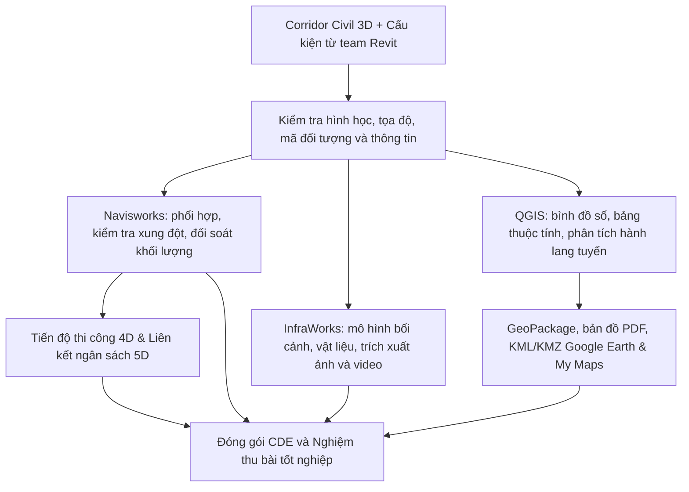

# BIM Tuyến 2027 — Giáo trình Thực hành & Ứng dụng Huấn luyện Kỹ sư BIM

[](https://www.autodesk.com)
[](https://www.qgis.org)
[](https://www.iso.org)
[](https://github.com/cloudflare/vinext)
[](LICENSE)

---

## 📖 Giới thiệu Dự án

Hệ thống tài liệu và ứng dụng hỗ trợ đào tạo thực chiến **BIM Tuyến 2027**, được thiết kế chuyên biệt cho kỹ sư hạ tầng giao thông (đường cao tốc, đường ngoài đô thị, cầu đường, thoát nước) chuyển dịch từ hình học 3D sang mô hình thông tin BIM toàn diện, diễn họa bối cảnh và phân tích không gian địa lý.

### Điểm khởi đầu thực tế của bạn:
- **Corridor tuyến Civil 3D đã hoàn thành** thiết kế bình đồ, trắc dọc, trắc ngang nhưng chưa gán vật liệu và thuộc tính BIM.
- **Team kết cấu đã có các cấu kiện Revit** (mố cầu, cống hộp, cống tròn, hố thu).
- Tuyến mẫu xuyên suốt: **Đoạn đường 2 km** có đầy đủ nền–mặt đường, taluy đắp/đào, rãnh biên, cống ngang và đoạn tiếp giáp mố cầu.

---

## 🔄 Sơ đồ Quy trình & Luồng Dữ liệu Đa Phần mềm



---

## 📚 Cấu trúc Giáo trình: 24 Chương (80 Bài học)

Toàn bộ giáo trình được chia thành **6 Module chuyên sâu**, có sẵn hướng dẫn chi tiết từng bước:

| Module | Tên Module | Phạm Vi Chương | Phần Mềm Chính | Tài Liệu Chi Tiết |
|---|---|---|---|---|
| **Module 1** | **Quy trình & Nền tảng BIM Tuyến** | Chương 1 — 4 | Quy trình, Civil 3D | [Xem Module 1](docs/curriculum/MODULE_1_QUY_TRINH_VA_NEN_TANG.md) |
| **Module 2** | **Mô hình hóa & Thuộc tính Civil 3D** | Chương 5 — 8 | Civil 3D, IFC 4.3 | [Xem Module 2](docs/curriculum/MODULE_2_CIVIL3D_SOLIDS_PROPERTIES.md) |
| **Module 3** | **Phối hợp & Kiểm tra Navisworks** | Chương 9 — 13 | Navisworks Manage | [Xem Module 3](docs/curriculum/MODULE_3_NAVISWORKS_COORDINATION.md) |
| **Module 4** | **Diễn họa & Trình bày InfraWorks** | Chương 14 — 17 | Autodesk InfraWorks | [Xem Module 4](docs/curriculum/MODULE_4_INFRAWORKS_VISUALIZATION.md) |
| **Module 5** | **Ứng dụng QGIS & Bản đồ Chia sẻ** | Chương 18 — 21 | QGIS, Google Earth | [Xem Module 5](docs/curriculum/MODULE_5_QGIS_SPATIAL_ANALYSIS.md) |
| **Module 6** | **Quản lý 4D/5D, CDE & Nghiệm thu** | Chương 22 — 24 | Navisworks, CDE | [Xem Module 6](docs/curriculum/MODULE_6_4D_5D_HANDOVER.md) |

Xem tổng quan mục tiêu và quy trình chi tiết tại [docs/curriculum/00_TONG_QUAN_VA_QUY_TRINH.md](docs/curriculum/00_TONG_QUAN_VA_QUY_TRINH.md).

---

## 🗂️ Tài nguyên Dữ liệu Thực hành Google Drive (`G:\My Drive\my`)

Dự án được kết nối chặt chẽ với kho dữ liệu thực tế trên Google Drive của kỹ sư:
- 📁 **`G:\My Drive\my\Hoctap\20240831_Tai lieu hoc Civil Design.pdf`**: Tài liệu thiết kế Civil Design, phối hợp Navisworks & InfraWorks.
- 📁 **`G:\My Drive\my\Hoctap\Hướng_Dẫn_Tổng_Hợp_Mô_Hình_BIM_GIS_Google_Gemini.pdf`**: Cẩm nang chuyển giao dữ liệu BIM sang GIS.
- 📁 **`G:\My Drive\my\Hoctap\VSI Academy - Quy Trình Kiểm soát Corridor Target trong Civil 3D.pdf`**: Hướng dẫn kiểm soát mục tiêu Corridor.
- 📁 **`G:\My Drive\my\GIS\Binh Dinh_DEM`**: Dữ liệu raster mô hình số độ cao phục vụ tạo bối cảnh InfraWorks và phân tích QGIS.
- 📁 **`G:\My Drive\my\GIS\Ranh hanh chinh moi 2025`**: Lớp dữ liệu ranh giới hành chính phục vụ thống kê giải phóng mặt bằng.

👉 Xem chi tiết bản đồ đối chiếu dữ liệu tại: [docs/references/GOOGLE_DRIVE_ASSETS.md](docs/references/GOOGLE_DRIVE_ASSETS.md).

---

## 📐 Trọn bộ Biểu mẫu Chuẩn Dự án (Templates)

Các biểu mẫu sẵn sàng áp dụng trực tiếp vào dự án thực tế:
1. [Biểu mẫu 01: Quy ước đặt tên file và Layer theo ISO 19650](docs/templates/01_PROJECT_NAMING_CONVENTION.md)
2. [Biểu mẫu 02: Từ điển thuộc tính Property Sets (PSD) chuẩn hóa](docs/templates/02_PROPERTY_SETS_DICTIONARY.md)
3. [Biểu mẫu 03: Ma trận kiểm tra xung đột (Clash Matrix) & Nhật ký Issue Log](docs/templates/03_CLASH_DETECTION_MATRIX.md)
4. [Biểu mẫu 04: Phiếu đối soát tọa độ mốc khống chế chung](docs/templates/04_COORDINATE_VERIFICATION_SHEET.md)
5. [Biểu mẫu 05: Bảng đối soát khối lượng 3D Solids vs 2D](docs/templates/05_VOLUME_RECONCILIATION_TEMPLATE.md)
6. [Biểu mẫu 06: Bảng ánh xạ thuộc tính BIM sang GeoPackage GIS](docs/templates/06_BIM_GIS_ATTRIBUTE_MAPPING.md)

---

## 💻 Ứng dụng Web Học tập Cá nhân (BIM Learning Hub)

Dự án tích hợp sẵn mã nguồn Web App học tập giao diện **Sổ tay kỹ thuật nền tối (Technical Dark Notebook)**:
- **Cột trái**: Mục lục 24 chương, tìm kiếm theo từ khóa lỗi/thao tác, lọc theo phần mềm (Civil 3D, Navisworks, InfraWorks, QGIS, 4D/5D).
- **Cột giữa**: Nội dung bài học, điều kiện tiên quyết, sơ đồ nguyên lý SVG tương tác, checklist từng bước thao tác (kèm kết quả mong đợi), lỗi thường gặp và cách khắc phục.
- **Cột phải**:
  - 📝 **Ghi chú cá nhân**: Tự động lưu, xuất file Markdown.
  - 📚 **Nguồn tra cứu**: Tra cứu nhanh tài liệu nội bộ và Google Drive.
  - 🤖 **Trợ lý AI Gemini**: Hỏi đáp kỹ thuật có trích dẫn nguồn cụ thể.

### Hướng dẫn chạy ứng dụng:

```bash
# 1. Cài đặt các thư viện phụ thuộc
npm install

# 2. Khởi chạy môi trường phát triển cục bộ
npm run dev

# 3. Mở trình duyệt truy cập:
# http://localhost:5173
```

---

## 🏆 Tiêu chí Nghiệm thu Bài Tốt nghiệp (Capstone Deliverables)

Học viên hoàn thành khóa huấn luyện khi nộp đủ **4 nhóm sản phẩm nghiệm thu độc lập**:
1. **Mô hình phối hợp BIM (Navisworks NWD)**: Ghép đúng tọa độ, phân loại Search Sets, giải quyết 100% va chạm cứng, bảng khối lượng sai số < 3%.
2. **Bộ ảnh & Video diễn họa (InfraWorks)**: 1 video chất lượng cao dài 60–90 giây bay dọc tuyến và 5 góc nhìn phối cảnh đắt giá.
3. **Bộ dữ liệu bản đồ GIS (QGIS)**: Tệp `GeoPackage` chuẩn bảng thuộc tính, bản đồ PDF xuất bản và tệp KMZ kiểm tra xem được trên Google Earth.
4. **Hồ sơ bàn giao CDE**: Cấu trúc thư mục theo ISO 19650, đầy đủ biên bản đối soát mốc và nhật ký thay đổi thiết kế.

---

**© 2026 BIM Tuyến 2027 Coaching Hub.** Biên soạn và phát triển phục vụ công tác đào tạo thực chiến kỹ sư cầu đường Việt Nam.
